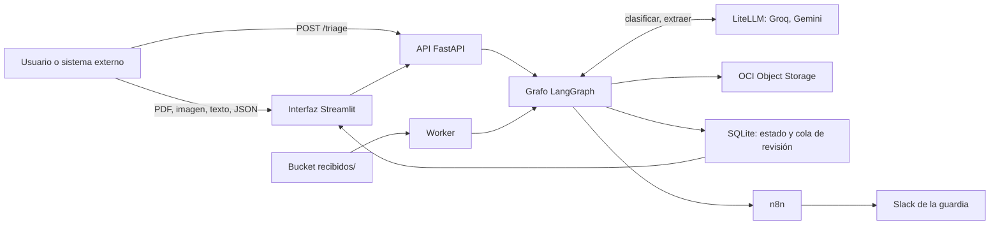

# Arquitectura

Última revisión: 27 de octubre de 2026. El README tiene la versión completa con el grafo de decisión y las reglas; este documento resume los componentes y dónde vive cada cosa.

## Componentes

| Componente | Tecnología |
|---|---|
| Modelo de lenguaje | LiteLLM con una cadena gratuita: Groq `qwen/qwen3.8-27b` como principal y Gemini Flash como respaldo (ADR-014). Mistral Small queda definido como tercer nivel, solo texto. Si ningún modelo responde, el agente sigue con reglas y marca el documento para revisión |
| OCR | Tesseract, para fotos y escaneos impresos |
| Orquestación | LangGraph, con estado tipado y pausa y reanudación para la revisión humana |
| Validación | Pydantic, un esquema por tipo de documento |
| API | FastAPI |
| Interfaz | Streamlit: carga, cola de triaje, auditoría, reglas, métricas y trazas |
| Documentos | OCI Object Storage, Always Free, con un bucket por entorno (`mediflow-dev` y `mediflow-prod`) |
| Estado del grafo y cola de revisión | SQLite en el volumen `mediflow-data` de la VM |
| Reglas | `agent/rules/rules.yaml`, editable desde la página Reglas con token de administrador |
| Alertas | n8n auto-hospedado → Slack de la guardia. Respaldos: Discord y OCI Notifications por correo |
| Cómputo | VM Ampere A1 en OCI, Always Free, con Docker Compose: `nginx`, `api`, `ui`, `worker` y `n8n` |
| Entrada HTTPS | Nginx con certificado de Let's Encrypt y dominio en DuckDNS |
| Secretos | `.env` en la VM, fuera del repositorio. Acceso al bucket con instance principal |
| CI/CD | GitHub Actions: lint y tests en cada PR; deploy a la VM en cada merge a `main`, con rollback automático |

Autonomous Database, APEX y OCI Vault estaban en el diseño inicial y quedaron fuera del MVP.

## Flujo



El grafo de decisión completo, con los colores de cada destino y las dos formas de intervención humana, está en el [README](../README.md#grafo-de-decisión).

## Layout de Object Storage

```
{bucket}/
  recibidos/{documento_id}.{pdf|png|jpg|txt|json}
  procesados/urgentes/{documento_id}.json
  procesados/farmacia/{documento_id}.json
  procesados/autorizaciones/{documento_id}.json
  procesados/historia_clinica/{documento_id}.json
  auditoria_humana/{documento_id}/original.{ext}
  auditoria_humana/{documento_id}/extraccion.json
  rechazados/{documento_id}.json
  checkpoints/{clave}.bin
```

En desarrollo, `STORAGE_BACKEND=local` escribe el mismo layout en `./data/{bucket}/`.
