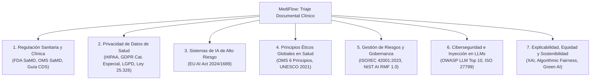

# MediFlow · Marco Integral de Gobernanza, Regulación y AI Ethics

Versión 1.0 · 22 de octubre de 2026 · Equipo 37 (ONE G10 / Oracle Next Education & Alura)

---

## 1. Declaración y Propósito

**MediFlow** es un sistema autónomo de asistencia operativa para el **triaje, extracción estructurada y enrutamiento administrativo de documentos clínicos**. Su propósito exclusivo es agilizar la clasificación y distribución documental en bandejas de trabajo hospitalarias (Emergencias, Farmacia, Autorizaciones, Historia Clínica o Auditoría Humana), reduciendo tiempos de espera administrativos sin intervenir en el juicio médico.

Al operar en la intersección de la tecnología de agentes inteligentes (LangGraph), Modelos de Lenguaje Grandes (LLMs) multimodales y la gestión de información médica sensible, MediFlow adopta un marco de **Gobernanza y Ética de Inteligencia Artificial desde el Diseño (*Ethics & Privacy by Design*)**.

Este documento formaliza los estándares regulatorios internacionales y locales que rigen la arquitectura del software, documenta los controles técnicos implementados y establece los límites éticos innegociables del sistema.

---

## 2. Cuadro Comparativo de Marcos Regulatorios y Estándares Éticos



### 2.1. Marcos Internacionales y Regionales

| Marco Regulatorio / Estándar | Ámbito de Aplicación | Impacto Crítico en MediFlow | Implementación y Evidencia Técnica en el Repositorio |
|---|---|---|---|
| **EU AI Act (Reglamento UE 2024/1689)** | Internacional / Unión Europea | **Clasificación de Alto Riesgo** (Sistemas de triaje o priorización de emergencias médicas, Anexo III). Obligación estricta de supervisión humana (*Human-in-the-Loop*), gestión de riesgos y trazabilidad inalterable. | Pausa durable y reanudación en `agent/nodes/revision_humana.py`, panel `ui/pages/3_Auditoria.py`, registro inmutable `trace` en `agent/schemas/contrato.py` (PR #86, PR #141). |
| **HIPAA / GDPR / LGPD / Ley 25.326 AR** | Privacidad de Datos de Salud | Protección reforzada de Datos Personales de Salud (PHI/PII). Exige **minimización de datos**, **seudonimización irreversible sin clave** y segregación estricta de accesos. | Seudonimización HMAC-SHA256 en `agent/privacidad.py`, políticas de privilegios mínimos IAM en `infra/oci/policies.txt` (PR #29), `docs/privacidad.md`. |
| **FDA SaMD / IMDRF / Guía CDS 2022** | Regulación Sanitaria y Clínica | **Línea divisoria del Alcance**: Demarcar que MediFlow no califica como *Software as a Medical Device* (SaMD) de diagnóstico asistido ni prescripción clínica. | `docs/alcance-y-limites.md`, regla de prompts "No diagnosticar" en `agent/prompts/clasificar.md`, tests de casos fuera de alcance FA-01 a FA-07. |
| **OMS: Ética y Gobernanza de la IA para la Salud (2021/2024)** | Ética Sanitaria Global | Cumplimiento de los **6 Principios de la OMS**: Autonomía, Seguridad/Bienestar, Transparencia/Explicabilidad, Responsabilidad, Equidad/Inclusión y Sostenibilidad. | Campo `evidencias` con citas textuales exactas en el contrato, catálogos neutros OPS/OMS para CIE-10 (ADR-008) y ATC/DCI para fármacos (ADR-006). |
| **UNESCO: Recomendación sobre la Ética de la IA (2021)** | Derechos Humanos y Equidad | Prohibición de discriminación algorítmica, equidad territorial y no amplificación de desigualdades demográficas o socioeconómicas. | Banco clínico multi-patología sintético en `evals/DATA.md`, datos 100% sintéticos sin sesgos de género o edad (ADR-005). |
| **ISO/IEC 42001:2023 (AIMS)** | Gobernanza de Sistemas de IA | Estándar certificable para el ciclo de vida de IA: control de versiones de prompts, registro de experimentos y monitoreo de deriva (*model drift*). | Harness automatizado `evals/run.py`, reportes oficiales de precisión y recall en `evals/resultados/`, observabilidad LLM con Arize Phoenix (PR #150). |
| **ISO/IEC 23894:2023 / NIST AI RMF 1.0** | Gestión de Riesgos de IA | Mapeo y mitigación de fallas críticas: alucinaciones, respuestas estocásticas y degradación de captura óptica. | Score compuesto de confianza en `agent/nodes/puntuar.py`, puerta de legibilidad *fail-closed* en `agent/nodes/normalizar.py` (PR #141). |
| **OWASP Top 10 for LLMs (LLM01, LLM02, LLM06, LLM08)** | Ciberseguridad en IA Generativa | **LLM01 (Prompt Injection)**: Neutralización de órdenes embebidas en documentos.<br/>**LLM02 (Insecure Output)**: Validación con Pydantic estricto.<br/>**LLM06 (Sensitive Info Disclosure)**: Trazas seguras.<br/>**LLM08 (Excessive Agency)**: Autonomía acotada sin acciones clínicas directas. | Guardarraíl 1 en `docs/guardarrailes.md`, prueba del caso hostil `FA-05`, esquemas de contrato con `extra='forbid'`, `detalle_seguro()` en `agent/privacidad.py`. |
| **Derecho a la Explicabilidad (XAI / Art. 22 GDPR)** | Derechos del Paciente | Prohibición de decisiones médicas automatizadas de "caja negra". Todo resultado debe ser auditable y comprensible para el operador clínico. | Desglose público del score en cuatro señales (legibilidad, validación, modelo, acuerdo) y justificación obligatoria en `decision_enrutamiento`. |
| **Green AI / Eficiencia Computacional** | Ética Ambiental | Minimización de la huella de carbono y optimización del uso de cómputo en inferencias multimodales en salud. | Prioridad a extracción de texto nativo vía PyMuPDF antes de visión (`agent/nodes/normalizar.py`), medición de tokens y costos por documento (`agent/llm/adapter.py`, PR #107). |

---

## 3. Demarcación de Alcance Clínico (Mitigación FDA / OMS)

Para garantizar la seguridad de los pacientes y evitar certificaciones SaMD de grado diagnóstico de años, MediFlow aplica tres principios de diseño innegociables:

1. **Principio de "No Interpretación Diagnóstica"**:
   El agente jamás interpreta radiografías, tomografías, trazados de ECG ni estudios histopatológicos. Su función es leer el informe emitido y firmado por un profesional humano habilitado. El módulo `agent/nodes/urgencia.py` opera bajo la **Regla A** ([ADR-002](decisions.md#L9)): listas de hallazgos críticos solo en informes y órdenes. En recetas y epicrisis, el agente evalúa el contexto documental sin emitir juicios clínicos nuevos.
2. **Principio de Cero Alucinación / Ausencia por Defecto (`null`)**:
   Un dato que no figure de manera explícita en el documento clínico original se asigna como `null`. El sistema jamás asume, completa o extrapola nombres, edades, matrículas ni posologías (Regla 3 de prompts en [docs/guardarrailes.md](guardarrailes.md)).
3. **Trazabilidad de la Evidencia Textual**:
   Toda extracción y detección de urgencia incluye el campo `evidencias` ([agent/schemas/contrato.py](file:///c:/mediflow/agent/schemas/contrato.py)), citando el string textual exacto que disparó la clasificación o la alerta. Una IA en salud nunca afirma una urgencia sin señalar la frase que la sustenta.

---

## 4. Gobernanza de Datos Sensibles (HIPAA / GDPR / LGPD / Ley 25.326 AR)

### 4.1. Seudonimización Criptográfica Irreversible sin Clave
*   La función `seudonimizar()` en `agent/privacidad.py` convierte los identificadores de pacientes en códigos estables del formato `P-<hmac_sha256_12>` utilizando una clave externa inyectada por variable de entorno (`MEDIFLOW_CLAVE_SEUDONIMO`).
*   La clave secreta jamás reside en el repositorio (`.env.example` la define vacía; en producción se gestiona vía el gestor de secretos de OCI).

### 4.2. Minimización de Trazas Públicas y Logs de Error
*   Las funciones `detalle_seguro()` y `registro_seguro()` en `agent/privacidad.py` sanitizan el campo `trace`:
    *   **Permitido:** enums tipados, scores normalizados (0 a 1), banderas booleanas y conteo numérico de campos/conflictos.
    *   **Estrictamente Excluido:** nombres de pacientes, números de documento, diagnósticos en texto libre, fragmentos de evidencia y rutas internas de archivos.
*   Los registros de errores de red o excepciones capturan únicamente la clase de la excepción (`type(e).__name__`), suprimiendo el mensaje crudo para evitar fugas de información.

### 4.3. Política de Proveedores de LLM y Fuga de Datos (ADR-010 y ADR-014)
*   **Fase de Desarrollo y Evaluación:** Se opera exclusivamente sobre un conjunto de prueba **100% sintético** (ADR-005, `evals/DATA.md`). En ninguna etapa del proyecto se utilizaron datos de personas reales.
*   **Fase de Producción Clínica Real:** Debido a que los términos de uso de capas gratuitas de APIs externas permiten la revisión humana y el entrenamiento de modelos, **MediFlow exige para datos reales de pacientes un proveedor bajo Acuerdo de Tratamiento de Datos (BAA / DPA) o el despliegue de modelos abiertos propios (como Qwen o Mistral) alojados dentro de la infraestructura privada u hospitalaria.**

### 4.4. Política de Retención y Borrado Seguro (Lifecycle en OCI)
Para cumplir con el principio de limitación de plazo de conservación (Art. 5(1)(e) GDPR y normas locales):
*   **`recibidos/`**: El archivo original se suprime una vez procesado y validado en su bucket de destino final.
*   **`procesados/`**: Conservación conforme a los plazos legales de guarda de historias clínicas (mínimo 10 años según Ley 26.529 AR), bajo cifrado en reposo AES-256 administrado por OCI.
*   **`rechazados/` y `auditoria_humana/`**: Retención transitoria de **30 días** para auditoría forense y control de calidad médico. Tras cumplirse el plazo, se aplica purga automatizada mediante *OCI Object Storage Lifecycle Rules*.

---

## 5. Supervisión Humana Activa (*Human-in-the-Loop* bajo EU AI Act)

El diseño del grafo de decisión de MediFlow garantiza que la Inteligencia Artificial permanezca subordinada al juicio humano en dos instancias diferenciadas:

```
[Entrada de Documento] 
         │
         ▼
[Score de Confianza < 0,60 o Ambigüedad AMB-1..6] ──► [PAUSA: Revisión Humana Previa]
         │                                                        │
         │ (Score >= 0,85)                                        ├─► Aprobar/Corregir ─► Destino Operativo
         ▼                                                        └─► Rechazar ─► archivado en rechazados/ (BLOQUEO)
[Urgencia Clínica o Alto Riesgo Farmacológico] ──────► [Destino Inmediato + Auditoría Humana Posterior]
```

1. **Revisión Humana Previa (Bloqueante)**:
   Documentos ilegibles, con campos faltantes (AMB-1), inconsistencias internas (AMB-2), dosis fuera de referencia (AMB-3), texto truncado (AMB-4) o solicitudes fuera de alcance (AMB-6) se detienen de inmediato en la Cola de Revisión Humana.
2. **Inmutabilidad del Rechazo**:
   Si el auditor clínico rechaza un documento en `ui/pages/3_Auditoria.py`, este se deposita en `rechazados/` con su acta digital `resolucion.json`. El software tiene una guarda a nivel de código que **impide de forma irreversible que un documento rechazado avance hacia la Farmacia o la Historia Clínica Electrónica**.
3. **Auditoría Posterior para Casos Críticos (No Demora)**:
   Para no retrasar la atención ante emergencias médicas o recetas de medicamentos de alto riesgo, el documento se envía a la cola correspondiente y de forma simultánea se genera una marca de auditoría para su revisión médica diferida.
4. **Mejora Continua desde el Error Humano**:
   Toda corrección efectuada por un auditor en el panel se exporta como un caso de prueba de regresión en `evals/regresion/`, asegurando que el sistema evalúe y prevenga la reincidencia algorítmica.

---

## 6. Mapeo de PRs, Issues y Decisiones Técnicas (ADR)

| Hito / PR / Issue | Módulo Afectado | Control Ético y Regulatorio Aportado |
|---|---|---|
| **ADR-002** | `agent/nodes/urgencia.py` | Regla A: Prohibición de clasificar urgencias por palabras sueltas fuera de informes técnicos. |
| **ADR-005** | `evals/golden/` | Conjunto 100% sintético; garantía de privacidad absoluta en entornos de prueba. |
| **ADR-006 / ADR-008** | `agent/rules/`, `evals/data/` | Adopción de catálogos internacionales neutros OMS (ATC/DCI y CIE-10 OPS) para evitar sesgos nacionales. |
| **ADR-010 / ADR-014** | `agent/llm/` | Demarcación de frontera de seguridad entre APIs gratuitas y modelos on-premise en salud. |
| **PR #29** | `infra/oci/policies.txt` | Segregación IAM de buckets por entorno (`mediflow-dev` vs `mediflow-prod`) y acceso restringido al auditor. |
| **PR #86 / Issue #64** | `agent/privacidad.py`, `agent/storage/respaldo.py` | Seudonimización HMAC-SHA256, listas permitidas en trazas y respaldo verificable con integridad SHA-256. |
| **PR #141 / Issue #62** | `agent/nodes/normalizar.py` | Puerta de legibilidad *fail-closed*: bloqueo automático de documentos con OCR degradado. |
| **PR #150** | Observabilidad LLM | Integración con Promptfoo y Arize Phoenix para trazabilidad y auditoría de inferencias. |

---

## 7. Cláusula de Exención de Responsabilidad (Clinical AI Disclaimer)

Para su visualización obligatoria en la interfaz de usuario ([ui/Home.py](file:///c:/mediflow/ui/Home.py)) y en el contrato de API ([docs/api-contract.md](file:///c:/mediflow/docs/api-contract.md)):

> **Aviso Legal y Ético (Clinical AI Disclaimer):**
> *MediFlow es una solución de soporte tecnológico orientada exclusivamente al triaje, extracción y enrutamiento administrativo de documentación clínica. El sistema NO constituye un dispositivo médico de diagnóstico, NO interpreta estudios por imágenes crudas ni reemplaza el criterio, prescripción o decisión de un profesional de la salud matriculado. Toda alerta o sugerencia de prioridad emitida por el sistema debe ser validada por personal clínico habilitado antes de cualquier conducta terapéutica.*
